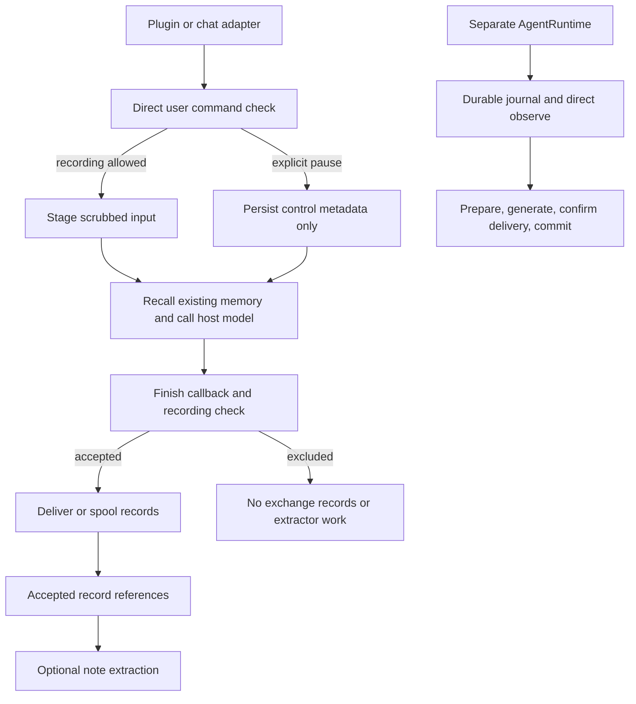

# Backend control flow and recording policy

This review covers the pre-release integration candidate and the first backend repair batch. It is not a complete security audit or a declaration of release readiness. The user requested module-by-module work instead of a continuing Goal. No new paid or subscription-backed acceptance was started for this review.

## Responsibilities and current paths

| Layer | Responsibility | Current implementation |
| --- | --- | --- |
| Host adapters | Identity, real user/assistant events, context insertion, available tools | Plugin hooks, ChatMemory/proxy, OpenClaw and Hermes call the shared host layer |
| Host lifecycle | Privacy controls, staging, recall composition, delivery/spooling | `host.py`; local session markers and pause state |
| Durable AgentRuntime | Capture, preparation, generation, delivery confirmation, recovery | `runtime.py` and durable turn journal; separate from host staging |
| Public API/SDK | Authenticated memory actions and explicit controls | HTTP, Python, TypeScript and MCP interfaces |
| Memory service | Transactional event/knowledge state, retrieval and lifecycle dependencies | `service.py`, cognition, semantic retrieval, learning and jobs |
| Persistence | Ownership, constraints, RLS, migrations, vectors and recovery | PostgreSQL, pgvector, JSONB; no new storage system is needed for this repair |

Framework dependencies stay outside the core. The main architectural issue is that the host lifecycle and durable AgentRuntime have different capture/control contracts. Moving functions between files alone would not unify those contracts.

## Confirmed defects addressed in this batch

1. The tool-free proxy had no deterministic pre-storage response to an explicit off-record request. Avoiding sensitive extracted notes did not exclude raw conversation history. The public English/Chinese reproductions retained after the fifth acceptance now exercise a shared pre-staging policy, also checked by finish-only callbacks.
2. A pause before the first staged message lacked that session in its conversation scope. The pause operation can now include the originating session explicitly without writing its text.
3. Finish callbacks returned all planned records even when a later pause caused `deliver` to reject them. They now return only accepted delivery/spool receipts, so downstream extraction cannot treat a rejected user record as evidence.
4. Local MCP `memory_observe` did not check pause, although `memory_note` did. Both content-writing tools now check local recording state. Remote MCP without a local installation still has caller-managed policy.
5. Ending a conversation pause read its state before taking the state lock. The read and removal now share the lock, avoiding deletion of a concurrently replaced pause based on an old snapshot.
6. A finish callback with no staged or explicitly supplied input could store an orphan assistant reply after a failed prompt hook, or revive a private reply after pause/resume and a duplicate finish. Three public tests reproduced this on the first repair. Finish now requires a staged or supplied input before accepting an assistant reply; hooks still let the host answer when memory is unavailable.

The initial regression run exposed a duplicate-processing error in the new finish fallback: it could reinstate a pause after a user had resumed. The repair preserves a staged exclusion without replaying its control. The existing extraction regression remains unchanged and is rerun; a focused test also checks that later public turns can be recorded after resuming.

## Policy boundaries

- Only a direct opening control clause matching the documented English/Chinese grammar changes state. No model call, embeddings or new database migration is needed to recognize it. A quote, reported speech, translation request, or confidentiality-only request is not a pause command.
- Automatic pause uses the existing conversation scope and includes role-play through the real person's identity. It does not shorten a pre-existing timed or until-resumed pause. Other users and separate group brains keep their controls.
- Raw input, its assistant reply and automatic extraction are excluded for a protected turn. A same-turn resume cannot resurrect an explicit exclusion. New-conversation and later-turn resume semantics remain those of the existing host controls.
- Previously stored or queued records are not retroactively erased. The host and upstream reply model still receive the conversation. This is not a general no-processing guarantee.
- Direct SDK/HTTP writes and AgentRuntime are separate interfaces: the local pause files do not constitute a transactional server-wide policy. This batch must not be described as making every backend entry point private by default.

## Next architectural work, in priority order

1. Define a server-owned recording policy shared by the durable runtime and host lifecycle. An ephemeral turn must have a deliberate generation/delivery/recovery contract; simply skipping `observe` breaks the runtime's source references. Explicit API controls should be authoritative, with natural-language recognition only an adapter convenience.
2. Make host pending state genuinely per turn, not one mutable pending slot per session. Qualify overlapping requests and late/repeated finish callbacks. Bind supplied proxy session IDs to the authenticated identity, group and role-play instead of relying on callers to choose globally unique headers. These are identified review targets, not fixes claimed by this batch.
3. Specify which writes can already be in flight when a pause is acknowledged. Local file checks and network writes do not form one database transaction; stronger guarantees need service-side policy/version checks, rather than holding a global file lock during all network calls.
4. Normalize delivery receipts across adapters and the durable journal. Keep recorded, queued, rejected, unknown delivery and model-generated claims distinct. Evaluate cancellation and crash recovery against those states.
5. Review retrieval/database cost with the existing 10,000-memory baseline, then larger and passage-heavy workloads. Preserve source/candidate parity where required; a structural refactor is not itself a performance improvement.

A zero-provider [overlap probe](../evaluations/evidence/backend-recording-policy-2026-11-07/same-session-overlap.json) confirms the pending-slot issue: two owners reuse a session ID, and the first owner's finish receipt contains the second owner's pending user record. Stored records retain their original owner, so this probe does not demonstrate cross-user database disclosure. It demonstrates incorrect callback receipts and missing user records in a later receipt, which can break source-linked extraction. The probe is retained as an existing defect, not a passing acceptance check.

## Verification scope

The new regression suite exercises grammar false positives, source-free staging and spooling, extractor suppression, role-play and user/group separation, restarts, existing timed pauses, same-turn resume, finish-only hosts, rejected receipts, local MCP, and streaming/non-streaming proxy requests through real embedded PostgreSQL. Existing host, plugin, adapter, extraction and MCP tests are also checked. CI and final counts belong to the pull request and verification report, not this design document.

The historical fifth acceptance remains R4 failed and C5 invalid/unscored. Public deterministic regression checks cannot establish held-out model behavior or clear release gates. Main merge, tag and package publication remain blocked by those gates.

## Concurrent-turn follow-up

The [turn-isolation batch](../evaluations/backend-turn-isolation-2026-11-07.md) implements the second follow-up above. It retains the failing overlap probe as baseline evidence and adds reverse-order completion, shared-owner privacy, capacity, migration, erasure and proxy-scoping regressions. Its report records qualification separately; the original review is not retroactively treated as a pass.

## Server ingestion follow-up

The [server recording-control batch](../evaluations/backend-server-recording-2026-11-07.md) adds an authenticated, revisioned per-brain policy and serializes it with source ingestion using the existing database lock. It closes unfinished durable turns without reviving them on resume, and prevents hosts from spooling explicit server rejections. This is the first server-side part of follow-ups 1 and 3. Local conversation/timed policies are not synchronized to this separate whole-brain switch; ephemeral durable turns and crash-atomic host delivery still need their own contracts. The older local-pause findings above retain their original scope.

The subsequent capture-revision fence connects server policy reads to host staging and replay. Input and its reply retain the capture revision; pause followed by resume invalidates older queued observations. Known pauses remain effective offline and cannot be cleared by local resume. This closes the delayed-observation gap without widening a local conversation pause to the entire brain. Reverse synchronization, derived-note fencing, ephemeral turns and atomic host delivery remain separate work; a disconnected host cannot immediately discover a remote change.

## Background note extraction follow-up

The [recording-fenced extraction batch](../evaluations/backend-extraction-recording-fence-2026-11-08.md) carries the source turn's server recording target/version through queued extraction, provider retries and note submission. Exact-source reads include the recording policy in their existing transaction; stale or paused queued tasks do not dispatch a provider call. New note writes recheck the frozen revision under the brain lock used by pause/resume, before replacements, feelings or request records. An already-dispatched provider call cannot be recalled; its stale result cannot become a new note. Already committed idempotent retries remain acknowledgements, not new writes.

This closes the automatic ChatMemory/proxy extraction path, not every derived-writing path. Manual host note tools and custom clients that omit the optional capture revision still need their own operation-lifetime contract; separately scheduled cognitive learning remains distinct. Local conversation/timed control synchronization, an ephemeral durable-turn mode and crash-atomic delivery remain open. Existing source reads, export and deletion remain available while recording is paused. The first backend module is still incomplete, and this engineering change does not clear R4/C5.

## Background cognitive learning follow-up

The learning queue now reads the same locked server recording policy during task claiming, provider-operation reservation and publication. Unstarted orientation/consolidation tasks stay queued while paused; their first claim binds the current policy revision. Existing attempts keep their revision across automatic retries and restarts. Paused or stale attempts cannot prepare new snapshots, renew processing, reserve another call or publish a result. Usage settlement remains available so an already dispatched operation is not forgotten or refunded. Historical integration's alternate failure/defer path checks the same guard.

Interrupted tasks report `recording_paused` or `recording_stale` and need explicit recovery after resume; a recovery authorization preserves the original failure and spending while allowing a new task under the current recording policy. Work that never started can begin after resume. Indexing and retrieval of already recorded history remain available. This does not synchronize the separate local conversation/timed controls, provide an ephemeral durable-turn mode or make host delivery crash-atomic. Manual tool capture also remains open. Runtime-bound verification belongs in the accompanying qualification report.

## Manual host tool follow-up

Lifecycle-integrated note tools now consume an opaque `recording_capture` from the original staged turn. The bounded session marker keeps its owner, nonce and captured server revision/target; execution does not refresh them. Plugin, plugin MCP, Hermes, ChatMemory, AstrBot and OpenClaw use the shared resolver. Plugin MCP observations use the same authority. A local pause revokes both active and completed captures for the affected owner and role-plays; later resume cannot restore them. Server policy changes reject stale note writes in the existing transaction before replacements or affect records are persisted.

The standalone desktop MCP connection remains explicitly tools-only and caller-managed; its lack of prompt hooks is not disguised as full lifecycle integration. It reports whether capture is required and never drops a supplied capture silently. Direct SDK writes and Hermes file imports/mirroring retain their separate contracts. Local-only pause acknowledgement still cannot cancel a network call that already passed the local check. Reverse synchronization, ephemeral durable turns and crash-atomic delivery remain open. See the manual-tool section of the [reference](../docs/reference.md#manual-tools-and-original-turn-recording-permission) for upgrade and retention behavior. Qualification is reported separately, and historical R4/C5 failures remain unchanged.

## Recoverable host delivery follow-up

Host completion and abandoned-input recovery now journal their scrubbed payloads before removing staged copies. Queue admission enforces the whole batch's encoded byte limit and synchronizes writes; a full queue retains the unfinished stage, while failed/short writes do not acknowledge completion. Replay retains source identities and recording revisions. Interrupted delivery can therefore repeat a request idempotently, including after the server committed it but before the client acknowledged it. Queue admission and local erasure cleanup share ordered session and queue-write locks. Replay and remote erasure still serialize on the replay lock, but new queue admissions do not wait for network replay. Session and queue-write locks are held only for local state transitions, not network calls. A damaged UTF-8 tail is isolated from later records.

This is a local journal plus idempotent server delivery, not one distributed transaction. User and assistant observations remain separate server transactions, so a reader can see a partial exchange during replay. A callback that failed before queue admission needs host retry, and abandoned-input recovery cannot reconstruct an unaccepted reply. Already queued records follow existing local-pause semantics, while server policy changes still reject stale replay. General receipt normalization across the independent durable AgentRuntime, ephemeral turns and local/server control synchronization remain open. Verification and measured filesystem overhead are reported separately; this change does not clear historical R4/C5 failures.
